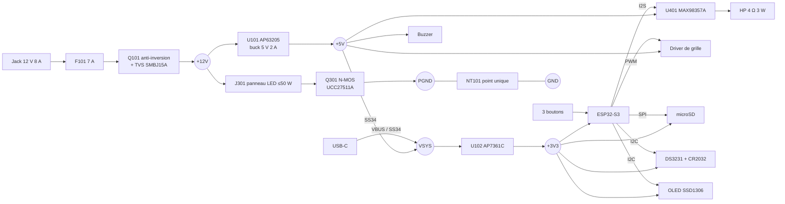

# AuroraWake V2 — Carte réveil ESP32-S3 (12 V)

Projet KiCad 9, **schéma complet sur une seule feuille A1** (8 blocs fonctionnels encadrés), généré depuis [tools/design.py](tools/design.py).
ERC : **0 erreur, 1 avertissement accepté** (pad thermique du MAX98357A, de type « unspecified », relié à GND).
Le schéma est exporté en PDF dans [docs/AuroraWake_schema.pdf](docs/AuroraWake_schema.pdf) et la BOM brute KiCad dans [docs/bom_kicad.csv](docs/bom_kicad.csv).

## 0. Décisions et hypothèses

| Sujet | Décision | Pourquoi |
|---|---|---|
| Entrée | Jack DC conservé : **CUI PJ-063AH, 8 A** | Un jack ne supporte pas 17 A, donc le **panneau est limité à 50 W (4,2 A)**. Courant total ≈ 4,9 A, soit environ 60 % du calibre du jack. |
| Panneau 60 W | Possible, avec un fusible NANO² **10 A** | 5,7 A au total : le fusible de 7 A fonctionnerait alors à 81 % de son calibre, au-delà de la règle des 75 %. La marge sur le jack se réduit. |
| Bloc d'alimentation | **12 V ≥ 6 A** (≥ 8 A pour un panneau de 60 W) | — |
| Module | **ESP32-S3-WROOM-1-N16R8** (module nu) | 16 Mo de flash pour les sons, 8 Mo de PSRAM pour les tampons audio. Un DevKitC-1 N16R8 suffit pour développer le firmware en attendant les cartes. |
| Fabrication | JLCPCB PCBA, **2 couches, cuivre 2 oz**, environ 100 × 80 mm | Les pièces traversantes (jack, bornier, boutons, buzzer, barrettes) sont soudées à la main ou en option THT. |
| Références LCSC | **Non renseignées** | À compléter au moment du rapprochement de la BOM chez JLCPCB. Chaque MPN est dans le champ `MPN` du symbole. |

## 1. BOM (justifiée)

Liste complète et regroupée : [docs/bom_kicad.csv](docs/bom_kicad.csv), soit 112 composants. Les composants structurants :

| Réf | Composant | Boîtier | Justification / alternative |
|---|---|---|---|
| J101 | Jack DC CUI PJ-063AH | THT | Jack 8 A. Broche centrale de 2,0 mm : **vérifier la fiche du bloc d'alimentation** (5,5×2,1). |
| F101 | Fusible Littelfuse NANO² 451, **7 A rapide** (0451007.MRL) | CMS 7,5 × 3,8 mm | 10 fois plus petit que le 5×20, assemblé par JLCPCB. Charge de 70 % à 4,9 A. L'appel de courant de C101 au branchement (≈0,3 A²s) reste très inférieur à l'I²t du fusible : à vérifier dans la datasheet. Soudé, donc non remplaçable ; pour un fusible remplaçable, utiliser le porte-fusible OMNI-BLOK 157x, de même encombrement. |
| Q101 | AOD4185 (P-MOS −40 V, ≈15 mΩ) | TO-252 | Protection contre l'inversion de polarité : 0,36 W de pertes contre ≈2,5 W pour une Schottky. Alternative : contrôleur de diode idéale LM74700 avec un N-MOS. |
| D101 | BZT52C15 | SOD-123 | Limite Vgs de Q101 à 15 V (maximum autorisé : ±20 V). |
| D102 | SMBJ15A (TVS 600 W) | SMB | Écrête les surtensions à ~24 V. Placée **après** Q101 pour ne pas être sollicitée en cas d'inversion. |
| C101 / C102 | 470 µF 35 V électrolytique / 10 µF 35 V X7R | 10×10,5 / 1210 | Réservoir pour les fronts PWM. L'électrolytique amortit le pic de branchement à chaud (risque élevé avec des céramiques seules). |
| NT101 | Net-tie 2 mm | SMD | **Seul** point de liaison PGND ↔ GND. |
| U101 | AP63205WU (buck 5 V / 2 A, Vin 3,8–32 V) | TSOT-23-6 | Sortie fixe 5 V, peu de composants, supporte 32 V (au-dessus de l'écrêtage TVS). Alternative : TPS563201, limité à 17 V, rejeté. |
| L101 | 4,7 µH, Isat ≥ 3,5 A (Bourns SRN6045TA) | 6×6 mm | Ondulation d'environ 0,56 A crête à crête à 1,1 MHz, soit 28 % de 2 A. |
| R102 / R103 | 100k / 15k sur EN | 0603 | Seuil de démarrage (UVLO) à ~9 V : pas de fonctionnement sur un bloc qui s'effondre. |
| D103 / D104 | SS34 | SMA | OU de diodes 5 V ↔ VBUS : la logique est alimentée par l'USB seul pour flasher. Alternative : un P-MOS en diode idéale pour gagner 0,4 V. |
| U102 | AP7361C-33E (LDO 1 A, chute 0,36 V) | SOT-223 | **Remplace l'AMS1117** : avec VSYS ≈ 4,55 V (après Schottky), la chute de 1,1–1,3 V de l'AMS1117 est trop juste. Stable avec céramiques. |
| U201 | ESP32-S3-WROOM-1-N16R8 | Module | Wi-Fi + BLE, USB natif, I2S, assez de GPIO. |
| U202 | USBLC6-2SC6 | SOT-23-6 | Protection ESD sur D+, D− et VBUS. |
| J201 | USB-C HRO TYPE-C-31-M-12 | SMD | Programmation et débogage via l'USB-Serial-JTAG intégré. CC1/CC2 tirées à GND par 5,1 kΩ. |
| J202 / J203 | Barrettes 1×6 UART / 1×8 extension+JTAG | 2,54 mm | Secours pour la programmation, sonde ESP-Prog. |
| Q301 | AOD4184A (N-MOS 40 V, ≈9 mΩ @ 4,5 V) | TO-252 | 0,2 W dissipés à 4,2 A. **L'IRLZ44N de la simulation SPICE n'est pas garanti à Vgs = 3,3 V.** |
| U301 | UCC27511A (driver de grille 4 A) | SOT-23-6 | Sorties OUTH/OUTL séparées (Ron 10 Ω / Roff 4,7 Ω). Alimenté en 5 V, donc Vgs reste toujours sous 20 V. Entrées compatibles 3,3 V. |
| D301 | SS54 (5 A 40 V) | SMC | Roue libre sur l'inductance du câble du panneau. |
| J301 | Bornier 5,08 mm 2 points (≥ 15 A) | THT | Raccordement du panneau. |
| U401 | MAX98357AETE+T | TQFN-16 3×3 | Classe D I2S, 3,2 W / 4 Ω, pas de DAC externe. |
| FB401–403 | Ferrites 0805, 2 A | 0805 | Isolent le 5 V audio et filtrent la CEM sur les fils du haut-parleur. |
| BZ401 / Q401 | Buzzer passif 12 mm + AO3400A + 1N4148W | THT / SOT-23 | Alarme de secours si la carte SD est absente. |
| J501 | microSD Hirose DM3AT avec détection de carte | SMD | Push-push, avec détection. |
| U501 | TPD4E05U06 | USON-10 | ESD sur CLK, CMD, DAT0 et DAT3. **Pas de translateur de niveau** : la carte SD est en 3,3 V, comme l'ESP32. |
| U601 | DS3231SN# | SOIC-16W | TCXO ±2 ppm (DS3231M : ±5 ppm). Les broches NC 5–12 sont reliées à GND. |
| BT601 | Porte-pile CR2032 Keystone 3034 | SMD | Autonomie > 5 ans. |
| J701 | Barrette femelle 1×4 pour module OLED SSD1306 0,96" 128×64, I2C 0x3C | THT | **Vérifier l'ordre GND/VCC du module acheté.** |
| SW801–803 | Boutons 6×6 mm, H8 | THT | Antirebond RC 10k/100 nF (τ = 1 ms) et 1k en série. |

## 2. Architecture et budgets

### Budget de courant

| Rail | Consommateur | Typique | Crête |
|---|---|---:|---:|
| +3V3 | ESP32-S3 (Wi-Fi en émission) | 120 mA | 500 mA |
| | Carte SD (écriture) | 20 mA | 100 mA |
| | OLED, RTC, LED, pull-ups | 20 mA | 31 mA |
| | **Total 3V3** | **≈160 mA** | **≈630 mA** (LDO 1 A, dissipation de 0,2 W typique à 0,8 W en crête) |
| +5V | Ampli (3,2 W / 85 %) | 150 mA (≈0,5 W) | 750 mA |
| | Buzzer, driver de grille | — | 45 mA |
| | VSYS (rail 3V3 en amont du LDO) | 160 mA | 630 mA |
| | **Total 5V** | **≈310 mA** | **≈1,43 A** (buck de 2 A, soit 71 %) |
| +12V | Buck (rendement 88 %) | 0,15 A | 0,68 A |
| | Panneau LED 50 W / 60 W | 0–4,2 A | 4,2 / 5,0 A |
| | **Total à l'entrée** | | **4,84 A** (50 W) / **5,68 A** (60 W) |

Veille la nuit (écran au minimum, Wi-Fi coupé) : environ 20 mA sous 12 V.

Pertes à pleine charge (50 W) : fusible ≈0,5 W, Q101 0,36 W, Q301 0,2 W, contact du jack ≈0,4 W. Il faut 2–4 cm² de cuivre sous chaque TO-252, avec des vias thermiques vers la face inférieure.

### Largeur des pistes (IPC-2221, cuivre externe 2 oz)

| Chemin | Courant | Minimum calculé (ΔT 10 °C) | **Valeur retenue** (classe de net) |
|---|---:|---:|---|
| Jack → F101 → Q101 → +12V → J301 → Q301 → PGND → jack | 5,7 A | 1,66 mm | **≥ 3 mm ou polygones** (`PWR_LED`) |
| +5V, VSYS, +5V_AUD, BUCK_SW, +3V3, sorties HP | ≤ 2 A | 0,39 mm | **1 mm** (`PWR_5V`) |
| Signaux | — | — | 0,25 mm, isolement 0,2 mm (`Default`) |
| USB D+/D− | — | — | paire différentielle 0,3 mm / écart 0,15 mm, environ 90 Ω (`USB`) |

Ces classes de nets sont déjà déclarées dans [AuroraWake.kicad_pro](AuroraWake.kicad_pro).

### Règles de placement et de routage

1. **Trois zones** : PUISSANCE (jack, fusible, Q101, C101, J301, Q301, U301) sur un bord ; ALIMENTATION À DÉCOUPAGE (U101, L101) ; LOGIQUE (ESP32, SD, RTC, OLED) avec AUDIO (U401) en sous-zone.
2. **PGND** : polygone dédié, sur les deux couches dans la zone puissance. Le seul contact avec GND est NT101, au pied de C101. Aucun signal logique ne passe au-dessus de PGND.
3. **GND** : plan plein en couche inférieure sous la zone logique, cousu de vias tous les 5 mm environ. Pas de fente sous les bus I2S, SPI et USB.
4. **Boucle chaude du buck** (C103 → U101 → GND) : moins de 5 mm. Garder BUCK_SW court et ne pas mettre de plan sous L101 côté signal.
5. **Boucle de grille** (U301 → R301/R302 → Q301 → retour PGND) : la plus courte possible. U301 à moins de 10 mm de Q301.
6. **Antenne de l'ESP32** : le module déborde du bord de la carte, ou une zone sans cuivre de 15 mm (toutes couches) est réservée sous l'antenne et autour.
7. Découplage : chaque condensateur de 100 nF à moins de 2 mm de la broche alimentée, avec un via GND direct.
8. Isolement : 0,2 mm minimum (règles JLCPCB 2 oz), 0,3 mm sur le réseau 12 V de puissance. La basse tension ne demande pas d'exigence de sécurité particulière.
9. Pas de points de test dédiés : on mesure sur les pads des condensateurs de découplage (rails), sur les barrettes J202/J203 (UART, EN, IO0, 3V3) et sur les pattes des CI (bus).

## 3. Schéma KiCad

Tout est dans une seule feuille, [AuroraWake.kicad_sch](AuroraWake.kicad_sch), au format A1. Elle contient 8 cadres numérotés :

| Bloc | Contenu |
|---:|---|
| 1 | Alimentation : jack, fusible, anti-inversion, TVS, buck 5 V, OU de diodes, LDO 3,3 V, VIN_SENSE |
| 2 | Microcontrôleur : ESP32-S3, EN/BOOT, USB-C + ESD, UART, extension/JTAG, LED d'état |
| 3 | Panneau LED : driver UCC27511A, AOD4184A, roue libre, bornier |
| 4 | Audio : MAX98357A, filtres, haut-parleur, buzzer de secours |
| 5 | microSD SPI : pull-ups, ESD |
| 6 | RTC : DS3231SN, CR2032, pull-ups I2C |
| 7 | Écran : connecteur OLED SSD1306 |
| 8 | 3 boutons avec antirebond RC |

Les trous de fixation M3 (H1–H4) sont en bas à gauche. Chaque cadre contient un bloc de texte qui résume les choix et les risques. Les connexions passent par des labels de net locaux et des symboles d'alimentation.

**Régénérer :** `cd hardware/AuroraWake_V2 && python3 tools/gen.py .`. **Attention :** cette commande écrase `AuroraWake.kicad_sch`. Une fois la mise en forme faite à la main dans KiCad, modifie directement le schéma et n'utilise plus le script.

## 4. Attribution des GPIO

| GPIO | Fonction | Justification |
|---|---|---|
| IO0 | Bouton BOOT | Strapping : uniquement BOOT, avec pull-up de 10k. |
| IO1 | VIN_SENSE (ADC1_CH0) | ADC1 reste utilisable avec le Wi-Fi actif (ce n'est pas le cas de l'ADC2). |
| IO2 | RTC_INT (alarme DS3231) | Domaine RTC : réveil de deep-sleep par EXT0. |
| IO3 | **NC** | Strapping (source JTAG). |
| IO4 / IO5 / IO6 | BTN_SET / BTN_UP / BTN_DOWN | Domaine RTC : réveil par EXT1 sur n'importe quel bouton. |
| IO7 | BUZZER (PWM LEDC) | GPIO libre. |
| IO8 / IO9 | I2C_SDA / I2C_SCL | Brochage I2C par défaut de l'ESP-IDF et d'Arduino S3. |
| IO10 / 11 / 12 / 13 | SD_CS / MOSI / SCK / MISO | Broches **IO_MUX FSPI** natives : SPI rapide sans passer par la matrice GPIO. |
| IO14 | SD_DET | Détection de carte. |
| IO15 / IO16 / IO17 | I2S_BCLK / LRCLK / DIN | Bloc contigu. IO15/16 pourraient accueillir un quartz 32 kHz, inutile ici grâce au DS3231. |
| IO18 | AMP_SD (arrêt de l'ampli) | À 0 pendant le boot (pull-down interne du MAX98357A), donc pas de « pop » au démarrage. |
| IO19 / IO20 | USB D− / D+ | USB natif, figé par le matériel. |
| IO21 | LED_PWM | Hors strapping. Pull-down de 100k : le panneau reste éteint pendant le boot. |
| IO35 / 36 / 37 | **NC** | Réservés à la PSRAM octale (N16R8). |
| IO38 | LED d'état | GPIO libre. |
| IO39–42 | Extension / JTAG (J203) | MTCK, MTDO, MTDI, MTMS pour une sonde ESP-Prog si l'USB-JTAG ne suffit pas. |
| IO43 / IO44 | UART0 TX / RX (J202) | Console de secours. |
| IO45 / IO46 | **NC** | Strapping (tension VDD_SPI, mode de boot). |
| IO47 / IO48 | Extension (J203) | GPIO de réserve. |

Réglages firmware associés :
- LEDC à ~20 kHz en 11 bits pour la montée de luminosité (prévoir une courbe gamma) ;
- I2S en 44,1 kHz, 16 bits, sur le canal gauche ;
- SPI SD à 20–40 MHz ;
- I2C à 400 kHz.

## 5. Risques et points ouverts

- **Jack DC** : c'est le maillon faible. Au-delà de 50 W, passer à un bornier ou un XT30 et revoir F101 et les pistes.
- **Pull-ups du module OLED** et **ordre des broches** : à contrôler sur le module réellement acheté.
- **Disponibilité LCSC** : MAX98357A, UCC27511A et DS3231SN sont des pièces « extended » (frais de chargement par référence). Les alternatives sont listées dans la BOM ci-dessus.
- **Valeurs à confirmer avec les datasheets avant commande** : seuils de ~SD_MODE du MAX98357A (le canal gauche est choisi avec une large marge), Rds(on) de l'AOD4184A à 4,5 V, valeur exacte de L101 pour l'AP63205.
- **Étape suivante** : mise en forme graphique du schéma, affectation des références LCSC, puis placement du PCB de 100×80 mm selon les zones décrites ci-dessus.

## 6. PCB ([AuroraWake.kicad_pcb](AuroraWake.kicad_pcb))

Le PCB a été généré par [tools/pcb_build.py](tools/pcb_build.py) à partir de [tools/pcb_place.py](tools/pcb_place.py) (placement) et de [tools/pcb_route.py](tools/pcb_route.py) (cuivre de puissance). Les empreintes sont liées aux symboles : « Mettre à jour le PCB depuis le schéma » (F8) fonctionne.

**État actuel :**
- Carte de 100 × 80 mm, coins arrondis R3, 2 couches, 4 trous M3. Cuivre 2 oz : **à choisir à la commande JLCPCB** (option « Outer copper weight »), ce n'est pas inscrit dans les Gerber.
- 112 empreintes placées explicitement, sans ajustement automatique :
  - passifs alignés en rangées ou colonnes, à pas réguliers de 3 à 3,4 mm ;
  - même orientation dans chaque bloc ;
  - circuits intégrés alignés ;
  - 4 trous M3 symétriques ;
  - tous les connecteurs sur les bords.
- Disposition par zones (vue de dessus) :
  - haut-gauche : entrée 12 V ;
  - haut-centre : panneau LED ;
  - haut-droite : ESP32, antenne au bord supérieur ;
  - gauche-milieu : buck et LDO, sur une seule rangée alignée ;
  - centre : RTC, avec le buzzer sous l'ESP32 ;
  - centre-droit : audio ;
  - bas : boutons, OLED, microSD et haut-parleur, tous au bord ;
  - bord droit : USB-C, RESET/BOOT et barrettes.
- Le porte-pile CR2032 (BT601) est **sous la carte**, sous le RTC (soudure manuelle ou assemblage double face).
- Cuivre de puissance déjà fait :
  - zone **+12V** en face avant et plan **PGND** en face arrière, limités à la zone de puissance ;
  - pistes de 2,5 mm pour VIN_RAW, VIN_FUSED et LED_K ;
  - boucle Q301 → C303 ;
  - alimentation du buck ;
  - vias PGND ;
  - plans **GND** sur les deux faces partout ailleurs.
- Sérigraphie placée automatiquement par [tools/pcb_silk.py](tools/pcb_silk.py), sans chevauchement. **Tous les textes sont horizontaux**, lisibles depuis le bas de la carte. Repères de 0,8 mm. Seuls R301 et R204, faute de place, ne sont visibles que sur F.Fab, le plan d'assemblage. Le titre est au dos.
- **Routage terminé** : les signaux ont été routés par Freerouting, puis finalisés par [tools/pcb_finish.py](tools/pcb_finish.py).
- **DRC : 0 violation, 0 connexion manquante, 0 écart avec le schéma.**

**Finition après Freerouting** (`python3 tools/pcb_finish.py`, qui écrit d'abord une sauvegarde `AuroraWake.kicad_pcb.bak`). Le script ne modifie pas le placement, sauf l'échange FB402/FB403 et C404/C405 décrit plus bas.
- **Largeur des pistes** : Freerouting avait tracé des pistes de 0,187 mm, sous le minimum de 0,2 mm. Elles sont élargies à 0,2 mm.
- **Conflits d'élargissement** : les nets devenus trop proches de leurs voisins après élargissement sont supprimés puis reroutés.
- **Routeur A\*** sur grille de 0,1 mm et 2 couches. Il respecte les dégagements des classes de nets, les trous, la zone d'antenne et la zone de puissance. Il termine VBUS, +3V3, +12V, VIN_SENSE, PGND et les sorties audio.
- **Sorties audio** : elles se croisaient. OUTP (broche 9) est sous OUTN (broche 10), mais FB402 était au-dessus de FB403. FB402/FB403 et C404/C405 sont échangés, et `pcb_place.py` est corrigé en conséquence.
- **Masse de l'ampli** : les broches GND 11 et 15 de U401 sont reliées au pad central.
- **Vias vers les plans** :
  - PGND : C301, C302, R303 ;
  - GND : U501, ainsi que le blindage et la broche VSS (masse de la carte SD) du lecteur microSD.
- **+12V** : C303 (+) est relié explicitement au côté principal de la zone, coupée en deux par la rangée C102/D102/U301/Q301.
- **Plan GND** : environ 150 vias de couture, plus une via dans chaque îlot isolé.
- **Nettoyage** : suppression des pistes et vias pendantes signalées par KiCad.

**Ordre de routage manuel conseillé :**
1. Boucle du buck : C103/C104 → U101 → BUCK_SW → L101 → C106/C107, avec des pistes courtes et larges (classe PWR_5V, 0,8 mm).
2. Boucle de grille : U301 → R301/R302 → Q301 → retour PGND, et LED_PWM depuis IO21.
3. USB D+/D− en paire différentielle (routeur de paires, touche 6), du J201 vers U202 puis vers IO19/IO20.
4. Alimentations +5V, VSYS, +3V3 et +5V_AUD (0,8 mm), puis le découplage de l'ESP32 (C201/C202, au plus près de la broche 2).
5. Bus I2S, SPI SD, I2C, puis boutons et GPIO divers, en 0,25 mm.
6. Vias de couture GND (tous les 5 mm environ), puis re-remplissage des zones (touche B) et DRC.

Ne rien router sous l'antenne de l'ESP32 : la zone interdite de l'empreinte est active.

**Régénérer :** `python3 tools/pcb_build.py`. La commande refuse de s'exécuter si un routage manuel est détecté ; `--force` efface tout le routage.
